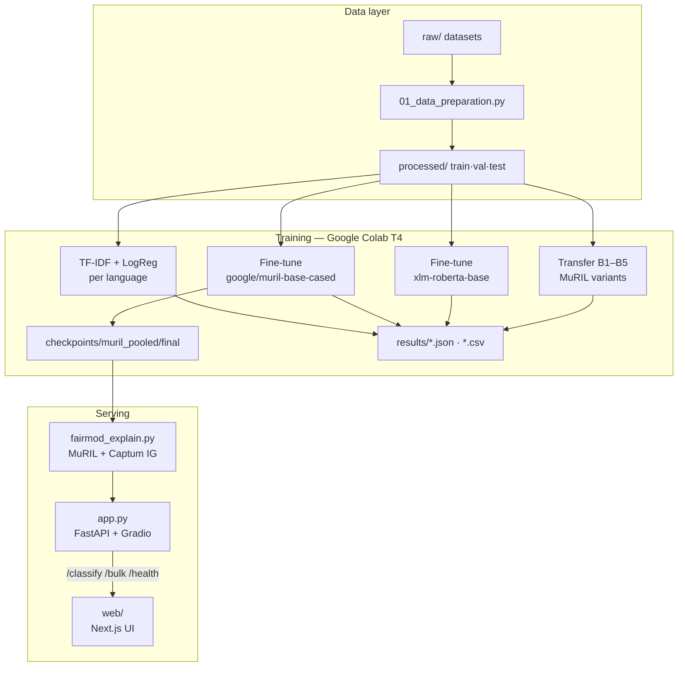
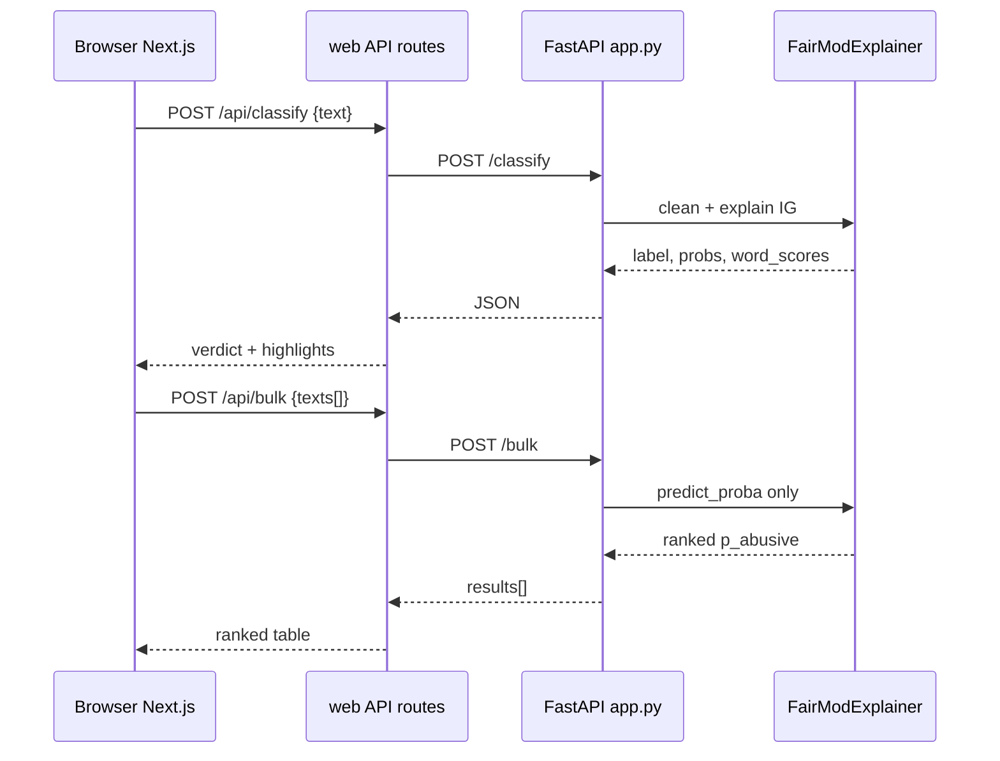
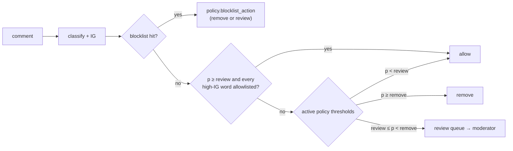

# FairMod — System Architecture & Technical Spec

Explainable abusive-comment moderation for **Hindi, Kannada, Marathi, and Bengali**.

This document is the technical map of what the system is built with, how data and models flow, and which models were trained.

---

## 1. High-level architecture



**Runtime split**

| Process | Port | Role |
|---|---|---|
| `python app.py` | `7860` | Loads MuRIL once; FastAPI API + Gradio UI |
| `cd web && npm run dev` | `3000` | Enterprise-style UI; proxies to FastAPI |

---

## 2. Technology stack (highlighted)

### 2.1 Machine learning & data

| Layer | Technology | Version / notes |
|---|---|---|
| **Primary model** | [`google/muril-base-cased`](https://huggingface.co/google/muril-base-cased) | ~236M params; Google MuRIL for Indic languages |
| **Comparison model** | `xlm-roberta-base` | Same data + training settings as MuRIL |
| **Baseline** | scikit-learn TF-IDF (char 2–5 grams) + Logistic Regression | One model **per language**; `class_weight='balanced'` |
| Training framework | Hugging Face `transformers` `Trainer` | Class-weighted cross-entropy |
| Data libs | `pandas`, `datasets`, `openpyxl` | CSV + Excel sources |
| Metrics | **macro-F1** | Never accuracy (class imbalance, esp. Bengali) |
| Seed | `42` | All splits and sampling |

### 2.2 Explainability

| Piece | Technology | Detail |
|---|---|---|
| Live explainer | **Captum** `LayerIntegratedGradients` | On embedding layer; `n_steps=32` |
| Reference explainer | **LIME** (`num_samples=500`) | Benchmark only; slower than IG |
| Aggregation | Whitespace words + tokenizer `offset_mapping` | Not regex `\w` (breaks Indic matras) |
| Shared module | `fairmod_explain.py` | Used by notebook 3 **and** `app.py` |

Highlight semantics (abusive class): **positive / vermillion** → pushed toward *abusive*; **negative / teal** → toward *normal*.

### 2.3 Backend API

| Piece | Technology |
|---|---|
| API framework | **FastAPI** |
| ASGI server | **uvicorn** |
| Demo UI (Spaces / paper) | **Gradio** mounted at `/` |
| Classifier load | `transformers` + **PyTorch** (CPU wheels in `requirements.txt`) |
| Endpoints | `POST /classify`, `POST /bulk`, `GET /health`, `GET /docs` |

### 2.4 Frontend (local product UI)

| Piece | Technology |
|---|---|
| Framework | **Next.js 15** (App Router) + **React 19** + **TypeScript** |
| Styling | **Tailwind CSS v4** |
| Fonts | Fraunces (display) + DM Sans (UI) |
| Proxy | Route handlers `/api/classify`, `/api/bulk`, `/api/health` → `FAIRMOD_API_URL` |

### 2.5 Training environment

| Piece | Choice |
|---|---|
| Compute | **Google Colab**, T4 GPU |
| Checkpoint storage | Google Drive `MyDrive/fairmod/checkpoints/` (~950 MB; not in git) |
| Paper | Overleaf, **IEEEtran** |

Pinned app deps: see [`requirements.txt`](requirements.txt). Web deps: see [`web/package.json`](web/package.json).

---

## 3. Models trained

All transformer runs use the same locked config unless noted.

### 3.1 Shared fine-tuning hyperparameters

| Parameter | Value |
|---|---|
| `max_length` | `128` |
| `per_device_train_batch_size` | `32` (effective batch kept at 32) |
| `learning_rate` | `2e-5` |
| `num_train_epochs` | `3` |
| `fp16` | `True` on GPU |
| Loss | Class-weighted cross-entropy |
| Checkpoint selection | Best **val macro-F1** |
| Labels | `0` = normal, `1` = abusive |

### 3.2 Model inventory

| ID | Base / method | Train data | Purpose | Artifact |
|---|---|---|---|---|
| **Baseline** | TF-IDF char 2–5 + LogReg | Per-language train | Table I column 1 | `results/baseline_results.json` |
| **MuRIL pooled** | `google/muril-base-cased` | Full multilingual train (~97.8k) | **Production classifier** for app + explainer | `checkpoints/muril_pooled/final` |
| **XLM-R pooled** | `xlm-roberta-base` | Same pooled train | Fair comparison (Table I) | run dir under `checkpoints/` + `results/xlmr_results.json` |
| **Transfer B1** | MuRIL | Zero-shot (no Kannada train) | Transfer curve | `results/transfer_B1_zero_shot.json` |
| **Transfer B2** | MuRIL | Few-shot Kannada **100** | Transfer curve | `results/transfer_B2_few_shot_100.json` |
| **Transfer B3** | MuRIL | Few-shot Kannada **500** | Transfer curve | `results/transfer_B3_few_shot_500.json` |
| **Transfer B4** | MuRIL | Few-shot Kannada **2000** | Transfer curve | `results/transfer_B4_few_shot_2000.json` |
| **Transfer B5** | MuRIL | Kannada monolingual | Transfer upper bound | `results/transfer_B5_monolingual.json` |

**App / Next.js load only one model:** `muril_pooled/final` (or `MODEL_ID` Hub repo).

Transfer target language = **Kannada**. Few-shot sets are nested (`100 ⊂ 500 ⊂ 2000`) and stratified by source × label. B1–B4 select checkpoints on **non-Kannada val** so Kannada labels do not leak via model selection.

### 3.3 Headline test macro-F1 (Table I)

From `results/table_I.csv` / `muril_results.json`:

| Language | TF-IDF + LogReg | XLM-R | **MuRIL** |
|---|---:|---:|---:|
| Hindi | 0.8369 | 0.8592 | **0.8624** |
| Kannada | 0.8441 | 0.8544 | **0.8581** |
| Marathi | 0.8919 | 0.9049 | **0.9100** |
| Bengali | 0.8864 | 0.8962 | **0.8995** |
| **Overall** | 0.8581 | 0.8728 | **0.8764** |

MuRIL pooled: `n_train=97793`, best val macro-F1 ≈ `0.877`, train ~27.5 min on T4 (recorded run).

---

## 4. Data architecture

### 4.1 Sources

| Dataset | Languages used | Role |
|---|---|---|
| MACD (ShareChat / NeurIPS 2022) | Hindi, Kannada | Donor + Kannada native script |
| L3Cube MahaHate (2-class) | Marathi | Underserved target |
| Bengali Hate Speech (Karim et al.) | Bengali | Underserved target |
| DravidianCodeMix | Kannada (Roman) | Code-mixed Kannada |

**Critical:** MACD labels are inverted in the raw files (`0` abusive, `1` normal). Notebook 1 flips them to the project standard (`1` = abusive).

### 4.2 Unified schema (`processed/*.csv`)

| Column | Type | Values |
|---|---|---|
| `text` | string | Minimally cleaned comment |
| `label` | int | `1` abusive, `0` normal |
| `language` | string | `hi` · `kn` · `mr` · `bn` |
| `source` | string | e.g. `macd`, `mahahate`, `bengali_hs`, `dravidian_kn` |

`test.csv` is **frozen**. Regenerating it invalidates published numbers.

### 4.3 Pipeline scripts / notebooks

| Artifact | Role |
|---|---|
| `01_data_preparation.py` | Load → fix labels → unify → dedupe → leakage check → save CSVs |
| `02_train.py` / `.ipynb` | Baseline + MuRIL + transfer + XLM-R |
| `03_explain_eval.py` / `.ipynb` | IG vs LIME benchmark, word-boundary check, error export |

---

## 5. Serving & request flow



| Endpoint | Cost | Output |
|---|---|---|
| `POST /classify` | Prediction + **Integrated Gradients** (~0.3–0.6s CPU) | label, confidence, probabilities, word_scores, truncated, latency_ms |
| `POST /bulk` | Batched `predict_proba` only | Ranked `{text, p_abusive, flagged}` (up to 2000) |
| `GET /health` | Cheap | model path + device |
| `POST /mod/moderate` (+ `/batch`) | `/classify` + list and policy checks + SQLite write | item with `auto_action`, `rule`, `auto_reason`, `status` |
| `GET /mod/items`, `POST /mod/items/{id}/decision` | SQLite | decision log, review queue, moderator decisions |
| `/mod/policies`, `/mod/lists` | SQLite | threshold presets and block/allow terms (all changes audited) |
| `GET /mod/analytics`, `/mod/audit`, `/mod/export.csv` | SQLite | dashboard numbers, audit trail, full CSV log |

Env: `MODEL_ID` = local folder or Hub id (`user/fairmod-muril`). Default: `checkpoints/muril_pooled/final`.
`FAIRMOD_DB` = moderation console database. Default: `data/fairmod.db`.

### 5.1 Moderation console pipeline (`moderation.py`)



Every outcome stores the policy name, the rule that fired and a statement of reasons
built from the top IG words. Moderator decisions append to the reason and to the audit log.

---

## 6. Repository layout (runtime-relevant)

```
NLP-moderation--underserved-languages/
├── 01_data_preparation.py      # data pipeline (Colab)
├── 02_train.py / .ipynb        # all model training
├── 03_explain_eval.py / .ipynb # explainer benchmark
├── fairmod_explain.py          # shared MuRIL + IG
├── app.py                      # FastAPI + Gradio
├── moderation.py               # /mod/* console: policies, lists, queue, log, analytics
├── test_moderation.py          # console tests (fake model, in-memory DB)
├── requirements.txt            # Python serve stack
├── data/                       # gitignored — fairmod.db (console data)
├── processed/                  # frozen train/val/test
├── results/                    # metrics for the paper
├── checkpoints/                # gitignored — muril_pooled/final
└── web/                        # Next.js product UI
    ├── app/api/*/route.ts      # proxies to FastAPI (api/mod/[...path] → /mod/*)
    ├── app/console/            # Dashboard, Ingest, Queue, Decisions, Policies, Lists, Audit
    └── components/             # Analyze, Bulk, highlights; console/ shell + shared UI
```

---

## 7. Design constraints (do not break)

1. Evaluate with **macro-F1**, not accuracy.  
2. Do not retrain under a different MACD label mapping without re-reading master context §4.3.  
3. Do not regenerate the frozen test set without a change-log + full re-run.  
4. Live explanations use **Captum IG**, not SHAP (SHAP deliberately out of scope).  
5. Production path is **one** multilingual MuRIL checkpoint, not four monolingual models.

---

## 8. Related docs

| Doc | Contents |
|---|---|
| [`FairMod_Master_Context.md`](FairMod_Master_Context.md) | Decisions, methodology, change log |
| [`README.md`](README.md) | Project status, how to run, results summary |
| [`web/README.md`](web/README.md) | Next.js local run |
| [`hf_space_README.md`](hf_space_README.md) | Hugging Face Spaces header |

---

*Architecture reflects the repo as of the Next.js UI + FastAPI `/bulk` addition. Checkpoint weights live on Drive / local `checkpoints/`, not in git.*
